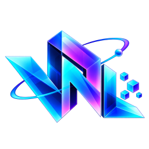

<p align="center"></p>

<h1 align="center">VFX NexgerLab</h1>

<p align="center">An offline pixel art VFX studio. Pick a live effect, change it, and export it into your game.</p>

<p align="center">English · <a href="README.th.md">ไทย</a></p>

> In development. There is no release yet.

## Development

```bash
npm ci
npm run dev
```

Electron cannot start inside some coding sandboxes. Run `npm run test:e2e` in a normal terminal.

## License

Business Source License 1.1. You can use it to make games, including paid games, and you own what you export. You cannot sell the software, offer it as a paid service, or build a competing tool with it. Each version becomes Apache-2.0 four years after its release. This is source-available, not open source.

## Made by

Nai Natthawut, NEXWEST LEDGER CORE COMPANY LIMITED.
