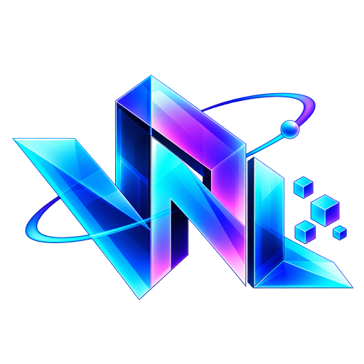
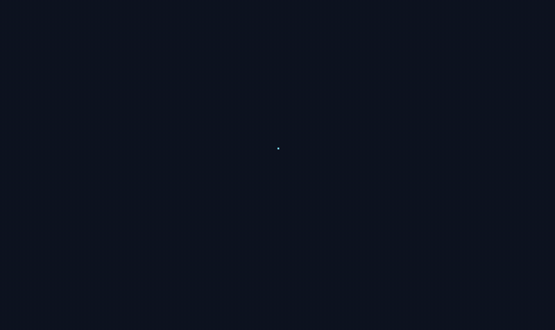
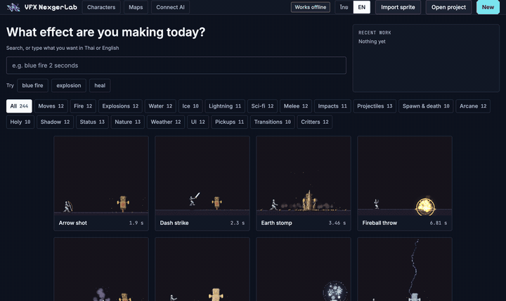
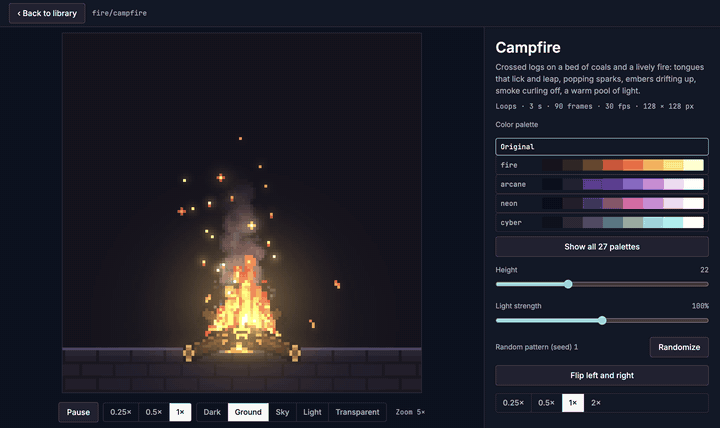
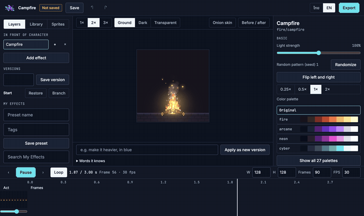
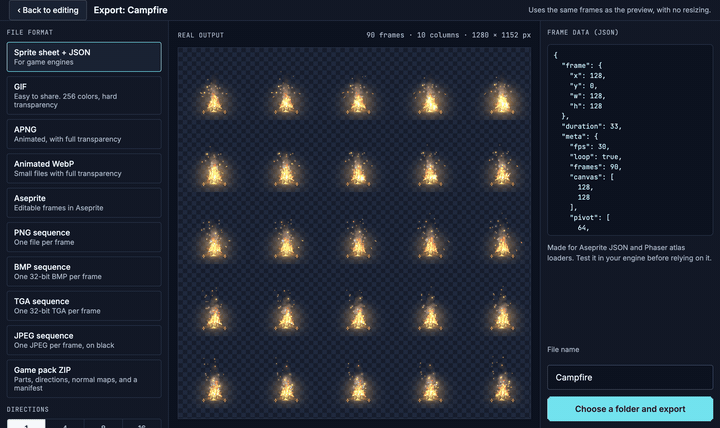
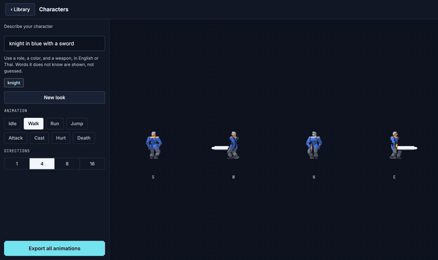
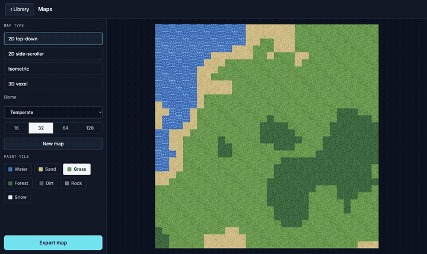
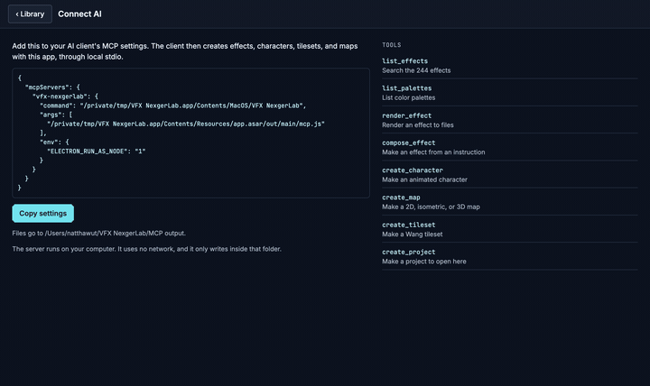
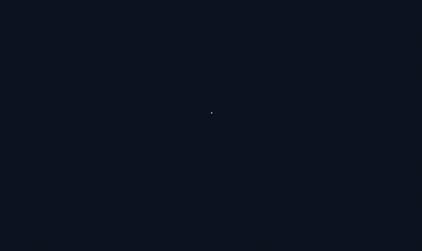

<p align="center"></p>

<h1 align="center">VFX NexgerLab</h1>

<p align="center">สตูดิโอออฟไลน์สำหรับเอฟเฟกต์พิกเซลอาร์ต ตัวละครเคลื่อนไหว และแมพเกม ที่ให้ AI สั่งงานได้</p>

<p align="center">
  <a href="https://github.com/NexwestLedgerCoreCompanyLimited/vfx-nexgerlab/releases/latest"><b>ดาวน์โหลด</b></a>
  ·
  <a href="https://github.com/NexwestLedgerCoreCompanyLimited/vfx-nexgerlab/actions/workflows/ci.yml"></a>
  <a href="https://github.com/NexwestLedgerCoreCompanyLimited/vfx-nexgerlab/releases/latest"></a>
  <a href="LICENSE"></a>
</p>

<p align="center"><a href="README.md">English</a> · ไทย</p>

<p align="center"></p>

## ดูการทำงาน

ภาพทั้งหมดมาจากโปรแกรมจริงพร้อมโปรเจกต์ตัวอย่าง

|                                                   |                                                   |
| :------------------------------------------------ | :------------------------------------------------ |
| **คลังเอฟเฟกต์แบบเคลื่อนไหว**                     | **Quick Look**                                    |
|      |  |
| **สตูดิโอ**                                       | **ส่งออก**                                        |
|          |          |
| **ตัวละคร**                                       | **แมพ**                                           |
|  |              |
| **เชื่อม AI**                                     | **เอฟเฟกต์ตอนเปิดโปรแกรม**                        |
|     |  |

## ทำอะไรได้บ้าง

- **เอฟเฟกต์:** คลังเคลื่อนไหว 244 เอฟเฟกต์ใน 21 หมวด ปรับชุดสี ความเร็ว seed แสง และตัวเลือกต่าง ๆ ได้โดยไม่ต้องเขียนโค้ด
- **ตัวละคร:** บอกบทบาท สี และอาวุธ แล้วได้ 8 อนิเมชันใน 1, 4, 8 หรือ 16 ทิศ
- **แมพ:** สร้างแมพ 2D มุมบน 2D ด้านข้าง ไอโซเมตริก และ 3D วอกเซล พร้อมทาสีช่องและ Wang tileset
- **สไปรต์:** ติดเอฟเฟกต์กับงานของคุณเอง พร้อมออร่า เรืองแสง แสง และเปลี่ยนสีทีละเฟรม
- **AI:** เซิร์ฟเวอร์ MCP stdio ในเครื่องให้ AI สร้างเอฟเฟกต์ ตัวละคร tileset แมพ และโปรเจกต์ได้
- **ภาษา:** อังกฤษเป็นหลัก และมีไทยครบ
- **เป็นส่วนตัว:** ทำงานออฟไลน์ ไม่มีบัญชี ไม่ใช้ API key และไม่ติดตามผู้ใช้

ตัวสร้างทั้งหมดเป็นโค้ดที่ให้ผลซ้ำได้ ไม่ใช่ AI สร้างภาพ ผลลัพธ์จึงคงที่และอยู่ในขอบเขตของมัน และจะบอกทันทีเมื่อเจอคำที่ไม่รู้จัก

### รูปแบบไฟล์

|           | รูปแบบ                                                                                           |
| :-------- | :----------------------------------------------------------------------------------------------- |
| นำเข้า    | PNG, GIF, JPEG, WebP, BMP, AVIF, Aseprite                                                        |
| ส่งออกภาพ | Sheet + JSON, PNG, JPEG, BMP, TGA, GIF, APNG, WebP เคลื่อนไหว, Aseprite, ZIP แพ็กเกม, normal map |
| ส่งออกแมพ | PNG, Tiled JSON, Wang tileset, GLB, OBJ                                                          |

ยังไม่รองรับไฟล์ Photoshop วิดีโอ และไฟล์โปรเจกต์เฉพาะของเอนจินเกม

### เชื่อมต่อ AI

เปิดหน้า **เชื่อม AI** ในโปรแกรม แล้วคัดลอกการตั้งค่าไปใส่ใน MCP ของโปรแกรม AI ไฟล์จะอยู่ที่ `~/VFX NexgerLab/MCP output` เซิร์ฟเวอร์ไม่ใช้เครือข่ายและเขียนไฟล์เฉพาะในโฟลเดอร์นั้น

เครื่องมือ: `list_effects`, `list_palettes`, `render_effect`, `compose_effect`, `create_character`, `create_map`, `create_tileset`, `create_project`

## ดาวน์โหลด

โหลดตัวติดตั้งได้จาก [Releases](https://github.com/NexwestLedgerCoreCompanyLimited/vfx-nexgerlab/releases/latest) แต่ละเวอร์ชันมีรีลีสของตัวเอง และตัวใหม่สุดจะมีป้าย Latest ตัวติดตั้งยังไม่ได้เซ็นรับรอง macOS และ Windows จึงจะเตือนก่อนเปิด

- macOS: [Apple silicon](https://github.com/NexwestLedgerCoreCompanyLimited/vfx-nexgerlab/releases/latest/download/VFX-NexgerLab-mac-arm64.dmg), [Intel](https://github.com/NexwestLedgerCoreCompanyLimited/vfx-nexgerlab/releases/latest/download/VFX-NexgerLab-mac-x64.dmg)
- Windows: [x64](https://github.com/NexwestLedgerCoreCompanyLimited/vfx-nexgerlab/releases/latest/download/VFX-NexgerLab-win-x64.exe)
- Linux: [AppImage](https://github.com/NexwestLedgerCoreCompanyLimited/vfx-nexgerlab/releases/latest/download/VFX-NexgerLab-linux-x86_64.AppImage)

## ทดสอบอะไรไปแล้วบ้าง

- Unit test และ end-to-end test บน Electron รวมทั้ง 244 เอฟเฟกต์เทียบกับพิกเซลที่บันทึกไว้ และเซิร์ฟเวอร์ MCP ผ่านโปรเซสจริง
- CI รัน end-to-end test และแพ็กโปรแกรมบน macOS, Windows และ Linux
- แอป macOS ที่แพ็กแล้ว เปิดจริงและส่งออกจริง
- ไฟล์ที่ส่งออกถูกถอดรหัสตรวจในเทสต์ ส่วน GLB และ Tiled ตรวจโครงสร้าง
- ยังไม่ได้ทำ: ลงตัวติดตั้งบนเครื่อง Windows และ Linux จริง, นำเข้าเอนจินเกมจริง, Blender, Tiled หรือ Aseprite, โปรแกรม AI จริงนอกเหนือจากเทสต์โปรโตคอล, ทดสอบการใช้งานกับคนจริง และให้เจ้าของภาษาตรวจคำไทย

## การพัฒนา

```bash
npm ci
npm run dev
```

Electron เปิดไม่ได้ใน sandbox ของเครื่องมือเขียนโค้ดบางตัว จึงควรรัน `npm run test:e2e` ในเทอร์มินัลปกติ

## เอกสารโปรเจกต์

[สเปกผลิตภัณฑ์](docs/vfx-nexgerlab-product-spec.md) · [การตัดสินใจ](DECISIONS.md) · [บันทึกการเปลี่ยนแปลง](CHANGELOG.th.md) · [การมีส่วนร่วม](CONTRIBUTING.md) · [การแปล](docs/TRANSLATING.md) · [การออกรีลีส](docs/RELEASING.md) · [ความปลอดภัย](SECURITY.md)

## กฎหมาย

VFX NexgerLab อนุญาตโดย NEXWEST LEDGER CORE COMPANY LIMITED ภายใต้ [Business Source License 1.1](LICENSE) ใช้ฟรีและเปิดเผยซอร์สโค้ด แต่ไม่ใช่โอเพนซอร์ส

| ทำได้                                             | ทำไม่ได้                                       |
| :------------------------------------------------ | :--------------------------------------------- |
| ใช้หาเงิน เช่น ทำเกมขายของคุณเอง                  | ขายโปรแกรมนี้ หรือฉบับที่ดัดแปลง               |
| คิดเงินลูกค้าสำหรับงานและผลงานที่ทำด้วยโปรแกรมนี้ | ให้เช่า หรือคิดเงินเพื่อเข้าถึงโปรแกรมเป็นหลัก |
| แก้ไขทุกอย่าง และต่อยอดได้                        | เก็บเงินค่าดาวน์โหลด รวมขายเป็นชุด หรือขายต่อ  |
| แจกฟรีภายใต้สัญญาอนุญาตเดียวกัน                   |                                                |
| ขายเอฟเฟกต์ ตัวละคร แมพ และเกมที่คุณสร้าง         |                                                |

**แต่ละเวอร์ชันจะเปลี่ยนเป็น Apache License 2.0 หลังออกรีลีสครบ 4 ปี** สำหรับเวอร์ชัน 0.2.0 คือวันที่ 2030-11-05

อ่านข้อความที่มีผลจริงได้ที่ [LICENSE](LICENSE) ตารางนี้เป็นเพียงสรุป เอนจินเอฟเฟกต์ใน `src/engine/pixelfx/` มาจาก [pixelfx](https://github.com/patch-gg/pixelfx) และยังคงอยู่ภายใต้ MIT License ดู [NOTICE.md](NOTICE.md)

## ผู้สร้าง

<a href="https://github.com/NexwestLedgerCoreCompanyLimited"></a>

**[Nai Natthawut](https://github.com/NexwestLedgerCoreCompanyLimited)** ผู้ก่อตั้ง [NEXWEST LEDGER CORE](https://nexwest.co.th) สร้างในประเทศไทยร่วมกับ Claude

<br clear="left">
